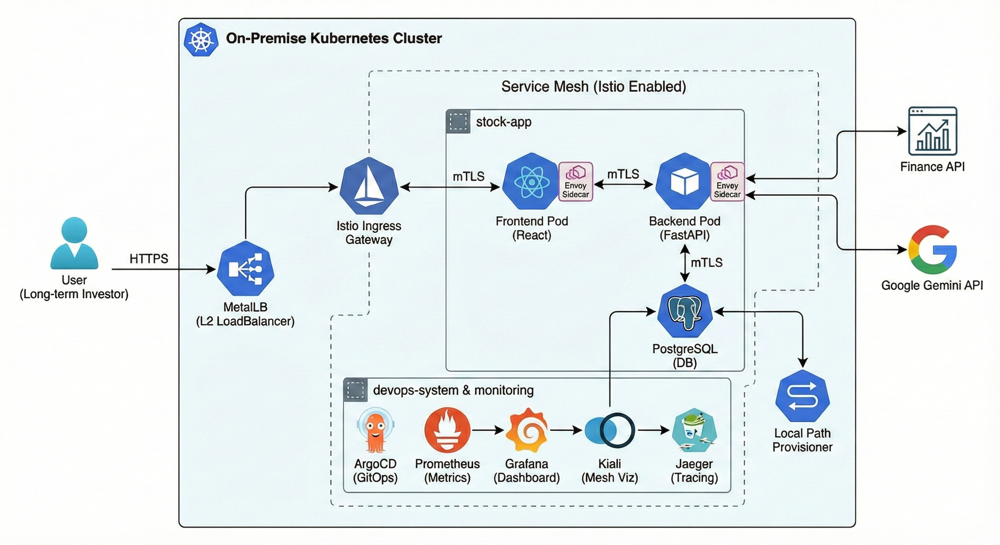

## 프롤로그: 프로젝트를 진행하게 된 계기?

현재 실무에서 **AWS EKS(Elastic Kubernetes Service)**를 운영하고 있습니다. 클라우드 제공자(CSP)가 관리해 주는 편리함 덕분에 비즈니스 로직에 집중할 수 있지만, 한편으로는 **"편리함 뒤에 숨겨진 Kubernetes의 본질적인 동작 원리"**를 깊이 이해하는 데에는 한계를 느꼈습니다.

**"매니지드 서비스(Managed Service)를 걷어내면, 과연 나는 클러스터를 바닥부터 구축하고 트러블슈팅 할 수 있는 엔지니어인가?"**

이 질문에 자신 있게 대답하기 위해, **베어메탈(Bare-metal)과 가장 유사한 로컬 가상화 환경에서 밑바닥부터(From Scratch) 클러스터를 구축**해보고자 합니다.

단순히 인프라만 구축하는 것이 아니라, 그 위에서 **Service Mesh(Istio)** 기술을 도입하여 현대적인 마이크로서비스 아키텍처의 정점인 **'가시성(Observability)과 보안(mTLS)'**이 확보된 환경을 직접 구성하는 것이 목표입니다.

---

## 1. 프로젝트 목표 (Goals)

이번 사이드 프로젝트의 핵심 목표는 다음과 같습니다.

* **Deep Dive into K8s:** `kubeadm`을 사용하여 클러스터를 직접 부트스트랩(Bootstrap)하며 트러블슈팅 능력 배양.
* **Service Mesh Implementation:** **Istio**를 도입하여 트래픽 제어(Traffic Management)와 mTLS 보안 통신 구현.
* **Full Observability Stack:** **Prometheus**(수집)를 중심으로 **Grafana**(시각화), **Kiali**(메쉬 토폴로지), **Jaeger**(트레이싱)를 연동하여 '보이지 않는 것을 보이게' 만듦.
* **Cost-Effective AI:** **Google Gemini API**를 활용하여 비용 부담 없이 고성능 주식 뉴스 분석 기능 구현.

---

## 2. 개발할 애플리케이션: Stock-Flow (가칭)

인프라 위에 올라갈 애플리케이션도 직접 개발합니다. 기존 증권사 MTS/HTS는 너무 많은 정보와 복잡한 호가창으로 인해 장기 투자자에게 피로감을 줍니다. 이 서비스는 **"Noise Canceling (노이즈 캔슬링)"**을 컨셉으로 합니다.

* **Extreme Simplicity:** 복잡한 호가창 제거. 오직 '현재가', '내 수익률', '심플 차트(TradingView)'만 제공.
* **AI Analyst (Powered by Gemini):** 사용자가 종목을 선택하면 AI Agent가 최신 뉴스를 분석하여 "3줄 요약" 및 "장기 투자 관점 코멘트" 제공.

---

## 3. 전체 예상 아키텍처 (Architecture)

## 4. 기술 스택 (Tech Stack)

### Infrastructure & Network
* **Virtualization:** Windows 11 + VirtualBox + Vagrant (IaC)
* **OS:** Ubuntu 22.04 LTS (Master 1, Worker 2)
* **Cluster Ops:** `kubeadm`, `kubectl`, `kubelet`
* **LoadBalancer:** **MetalLB** (L2 Mode - 온프레미스 환경에서 External IP 할당)
* **Storage:** Local Path Provisioner

### Service Mesh (Key Feature)
* **Core:** **Istio** (표준 서비스 메시)
* **Gateway:** **Istio Ingress Gateway**
* **Role:** 마이크로서비스 간 트래픽 관리, mTLS 보안, 가시성 데이터 생성.

### Application
* **Backend:** Python FastAPI
* **Frontend:** React (Next.js) + TradingView Lightweight Charts
* **AI Engine:** **Google Gemini API (2.5 Flash)**
    * *선정 이유:* 빠른 응답 속도와 개인 프로젝트에 최적화된 무료 티어 제공.

### DevOps & Observability
* **CI/CD:** GitHub Actions (CI), ArgoCD (CD/GitOps)
* **Metrics Pipeline:**
    * **Prometheus:** Istio 사이드카 및 노드 메트릭 수집/저장 (Time Series DB).
    * **Grafana:** Prometheus 데이터를 기반으로 대시보드 시각화.
* **Trace & Topology:**
    * **Kiali:** Prometheus 데이터를 분석하여 서비스 간 연결 관계 시각화.
    * **Jaeger:** 분산 트레이싱 추적.
* **Security:** Keycloak (SSO)

---

## 5. 앞으로의 로드맵 (Roadmap)

이 프로젝트는 아래 순서대로 진행하며, 각 단계별 트러블슈팅 과정을 블로그에 기록할 예정입니다.

1. **Phase 1: 인프라 기초 공사**
   * Vagrant VM 프로비저닝 및 사설 네트워크(192.168.56.x) 고정.
2. **Phase 2: 클러스터 구축**
   * `kubeadm` 초기화, Calico CNI 설치, MetalLB 구성.
3. **Phase 3: Service Mesh 도입 (High Difficulty)**
   * Istio 설치, Ingress Gateway 구성, Prometheus/Kiali/Jaeger 연동.
4. **Phase 4: 애플리케이션 개발**
   * FastAPI + Gemini 연동, React 차트 구현, Dockerizing.
5. **Phase 5: 운영 파이프라인 완성**
   * ArgoCD 배포 자동화, 모니터링 대시보드 구성.

---

**Next Post:**
다음 포스팅에서는 **Phase 1: Vagrant를 이용한 가상머신 프로비저닝**부터 시작합니다.